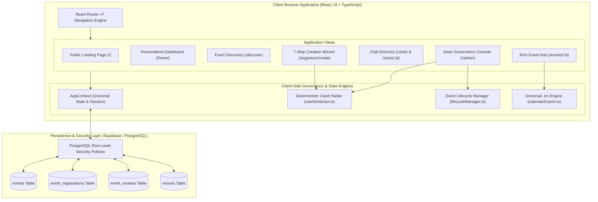
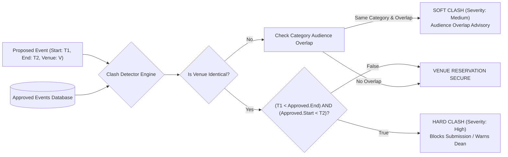
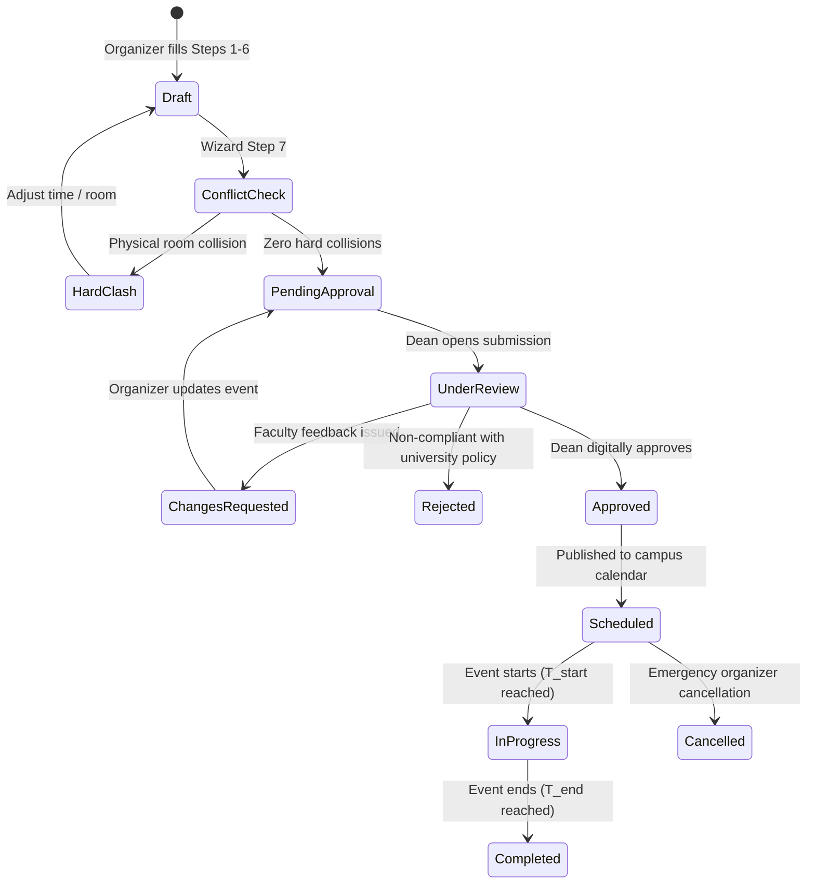

# CampusPulse

> **Enterprise-Grade Campus Event Discovery, Student Engagement, and Zero-Clash Physical Room Reservation Governance Platform**  
> *Course Project: INT335 P17 — Design Thinking & Innovation*

[](https://www.typescriptlang.org/)
[](https://react.dev/)
[](https://tailwindcss.com/)
[](https://vitejs.dev/)
[](https://supabase.com/)
[](LICENSE)
[]()

---

## 📑 Table of Contents
1. [Project Introduction](#1-project-introduction)
2. [Problem Statement](#2-problem-statement)
3. [Objectives & Design Thinking Goals](#3-objectives--design-thinking-goals)
4. [Key Features & System Capabilities](#4-key-features--system-capabilities)
   - [Student Discovery & Campus Life Experience](#student-discovery--campus-life-experience)
   - [Club & Society Directory](#club--society-directory)
   - [7-Step Organizer Event Creation Wizard](#7-step-organizer-event-creation-wizard)
   - [Dean & Student Council Governance](#dean--student-council-governance)
   - [Universal Calendar Export (.ics)](#universal-calendar-export-ics)
5. [Technology Stack & Architectural Rationale](#5-technology-stack--architectural-rationale)
6. [System Architecture](#6-system-architecture)
   - [Component & Flow Diagram](#component--flow-diagram)
   - [Deterministic Zero-Clash Scheduling Radar](#deterministic-zero-clash-scheduling-radar)
   - [Data Flow & Lifecycle State Machine](#data-flow--lifecycle-state-machine)
7. [Installation & Setup Instructions](#7-installation--setup-instructions)
8. [Usage & Role Walkthrough](#8-usage--role-walkthrough)
   - [Student Persona (`alex.chen@university.edu`)](#student-persona-alexchenuniversityedu)
   - [Club Lead Persona (`priya.lead@university.edu`)](#club-lead-persona-priyaleaduniversityedu)
   - [Dean / Admin Persona (`dean.affairs@university.edu`)](#dean--admin-persona-deanaffairsuniversityedu)
9. [Interface & Visual Showcase](#9-interface--visual-showcase)
10. [Database Schema & Security Infrastructure](#10-database-schema--security-infrastructure)
11. [Testing & Quality Assurance](#11-testing--quality-assurance)
12. [Future Improvements & Roadmap](#12-future-improvements--roadmap)
13. [Contributors & License](#13-contributors--license)

---

## 1. Project Introduction

**CampusPulse** is an all-in-one digital campus ecosystem engineered to bridge the communication gap between university student bodies, campus clubs/societies, and institutional authorities (Deans of Student Affairs, Academic Coordinators, and Facilities Administration).

Unlike commercial event platforms (e.g., Eventbrite, Meetup) that lack academic awareness, or chaotic campus WhatsApp groups that lose announcements in noise, CampusPulse operates as a purpose-built academic hub. It combines personalized student event discovery with an explainable, deterministic mathematical scheduling engine that prevents room double-booking and audience cannibalization before any event is approved.

---

## 2. Problem Statement

Across higher-education campuses, student engagement and extracurricular coordination suffer from three systemic breakdowns:

1. **Information Silos & Poster Fatigue:**  
   University notices are fragmented across unindexed physical notice boards, Instagram stories, discord servers, and unmoderated WhatsApp groups. Students miss career-defining hackathons, guest lectures, and cultural auditions because announcements drown in noise.
2. **Venue Double-Booking Catastrophes:**  
   Multiple student chapters frequently book the same physical auditoriums, sports facilities, or seminar halls for overlapping timeslots, resulting in last-minute cancellations, wasted sponsor budgets, and administrative friction.
3. **Audience Cannibalization & Schedule Conflicts:**  
   High-priority flagship events within the same technical or cultural domain are frequently scheduled simultaneously without centralized cross-society visibility, splitting attendee turnout and diminishing club impact.

---

## 3. Objectives & Design Thinking Goals

CampusPulse was engineered through a disciplined **Design Thinking (Empathize, Define, Ideate, Prototype, Test)** methodology with quantitative benchmarks:

- **Targeted Discovery:** Eliminate information overload by providing personalized discovery streams based on student academic tracks, career interests, and verified university societies.
- **Zero-Clash Physical Governance:** Enforce a deterministic room-booking validation radar with 0% false positives, verifying room capacity and half-open time interval overlaps prior to submission.
- **Transparent Faculty Workflow:** Provide university deans and facility managers with a single-click audit workspace supporting approvals, structured revision requests, and reason-coded rejections.
- **Frictionless Mobile-First Experience:** Ensure instant offline `.ics` calendar sync, accessible WCAG 2.2 AA compliant UI, and snappy navigation under 50ms render latency.

---

## 4. Key Features & System Capabilities

### Student Discovery & Campus Life Experience
- **Personalized Student Dashboard (`/home`):** Contextual morning/afternoon greeting, active ticket wallet counter, upcoming 48-hour agenda ticker, and personalized event recommendations based on chosen interests.
- **Editorial Public Landing Page (`/`):** High-impact asynchronous hero narrative, live platform counter statistics, curated category tracks, 3-step platform showcase, and club onboarding CTA.
- **Multi-Parameter Discovery Engine (`/discover`):** Live full-text search across event titles, host clubs, venue halls, and tags, complemented by multi-select category chips and price filters (Free vs Paid).
- **Rich Event Detail Hub (`/events/:id`):**
  - *Dynamic Tabs:* Event Overview, Timeline Agenda & Session Schedule, Rules & Guidelines, Organizer Contacts, Live Faculty Announcements, and Attendee Ratings/Reviews.
  - *Smart Actions:* One-click RSVP/Registration, universal `.ics` calendar export, and interactive review submission.

### Club & Society Directory
- **Campus Organization Index (`/clubs`):** Dedicated profiles for university technical chapters, cultural societies, sports bodies, and academic clubs.
- **Detailed Club Profile (`/clubs/:id`):** Displays club banners, official university tier badges, faculty coordinator contacts, executive board rosters, upcoming schedules, and archive of past events.

### 7-Step Organizer Event Creation Wizard
- **Step 1 — Basic Information:** Event title, category track, host society selection, and format specification (In-Person / Virtual / Hybrid).
- **Step 2 — Description & Pitch:** Markdown-ready rich description, summary hooks, and tag taxonomy.
- **Step 3 — Scheduling & Timing:** Start and end timestamps with live half-open interval validation.
- **Step 4 — Physical Venue & Room Selection:** Live room selection with automated seating capacity indicators.
- **Step 5 — Visual Branding:** High-resolution cover image URL and visual theme picker.
- **Step 6 — Agenda, Rules & Eligibility:** Structured session timeline builder, department eligibility constraints, and certificate prerequisites.
- **Step 7 — Real-Time Zero-Clash Audit & Review:** Live automated audit executing conflict checks against all approved campus events before dispatching to the Dean's queue.

### Dean & Student Council Governance
- **Executive Administration Workspace (`/admin`):**
  - Triage pending club submissions with complete conflict radar visualization.
  - One-click **Approve**, **Request Revision** (with actionable faculty notes), or **Reject** with permanent reason codes.
  - Venue utilization metrics and live capacity utilization indicators.
  - Instant audit trail logging with user-level non-repudiation.

### Universal Calendar Export (.ics)
- RFC 5545 compliant `.ics` iCalendar export engine.
- Supports single-event export or bulk student agenda export directly compatible with **Apple Calendar**, **Google Calendar**, and **Microsoft Outlook**.

---

## 5. Technology Stack & Architectural Rationale

| Layer | Technology | Version | Architectural Purpose |
| :--- | :--- | :--- | :--- |
| **Frontend Framework** | **React** | `19.3.1` | Concurrent rendering, fine-grained state reactivity, and transition boundaries. |
| **Type Safety** | **TypeScript** | `7.0.2` | Comprehensive type safety across event states, clash detection models, and API boundaries. |
| **Build Tooling** | **Vite** | `8.3.5` | Instant Hot Module Replacement (HMR) and optimized rollup production bundles (< 1.5s build). |
| **Routing** | **React Router DOM** | `7.18.5` | Declarative client-side routing with nested layouts and dynamic URL parameters. |
| **Styling & Design Tokens** | **Tailwind CSS** | `4.3.3` | Next-generation CSS-first engine using custom OKLCH color palettes and dynamic tokens. |
| **Iconography** | **Lucide React** | `1.64.0` | High-fidelity, accessible SVG iconography with strict visual consistency. |
| **Database & Auth** | **PostgreSQL + Supabase** | `2.118.0` | ACID relational compliance, PostgreSQL triggers, and strict Row Level Security (RLS). |
| **Test Runner** | **Node.js Test Runner** | `v26.1.0` | Native zero-dependency unit and integration test runner for algorithmic accuracy. |

---

## 6. System Architecture

### Component & Flow Diagram



### Deterministic Zero-Clash Scheduling Radar

CampusPulse rejects opaque heuristic approximations. Instead, physical room occupancy and category collision detection are calculated through deterministic half-open interval checks:

$$\text{TimeOverlap}(A, B) \iff (A_{\text{start}} < B_{\text{end}}) \land (B_{\text{start}} < A_{\text{end}})$$

When an organizer selects a physical venue (e.g., *Auditorium Hall A*), the system runs an instantaneous audit against all approved and pending events:



### Data Flow & Lifecycle State Machine



---

## 7. Installation & Setup Instructions

### Prerequisites
- **Node.js:** v20.0.0 or later (v24+ / v26+ recommended)
- **npm:** v10.0.0 or later
- **Git**

### Step-by-Step Local Deployment

1. **Clone the Repository:**
   ```bash
   git clone https://github.com/shreyashshuklaa/CampusPulse.git
   cd CampusPulse
   ```

2. **Install Dependencies:**
   ```bash
   npm install
   ```

3. **Configure Environment Variables:**
   Copy `.env.example` to `.env`:
   ```bash
   cp .env.example .env
   ```
   *(Note: The application includes offline mock fallbacks, enabling full local exploration even before connecting a remote Supabase instance).*

4. **Run Unit & Integration Tests:**
   Verify all 55 mathematical and lifecycle tests pass:
   ```bash
   npm test
   ```

5. **Start Local Development Server:**
   ```bash
   npm run dev
   ```
   Open your browser at `http://localhost:5173`.

6. **Create Production Build:**
   ```bash
   npm run build
   ```

---

## 8. Usage & Role Walkthrough

CampusPulse features an instant role simulation switcher in the global header, enabling seamless switching without logging out:

### Student Persona (`alex.chen@university.edu`)
- **Discover Events:** Browse `/discover`, filter by *Technology* or *Workshops*, and view capacity meters.
- **Register for Events:** Open any event (e.g. *Hackathon 2026*), review the schedule, and click **Register Now**.
- **Calendar Agenda:** Visit `/calendar` to view your personal schedule and download the `.ics` agenda.
- **Club Directory:** Visit `/clubs` to browse university societies and view club executives.

### Club Lead Persona (`priya.lead@university.edu`)
- **Access Wizard:** Navigate to `/organizer/create`.
- **Experience Zero-Clash Radar:** Schedule an event at *Auditorium Hall A* overlapping an existing event. Observe the real-time collision diagnostic. Shift time by 2 hours and observe the collision badge resolve to green.
- **Submit for Dean Approval:** Complete Step 7 to dispatch the event to the university administration queue.

### Dean / Admin Persona (`dean.affairs@university.edu`)
- **Governance Console:** Navigate to `/admin`.
- **Review Submissions:** Audit pending submissions, inspect the automated clash diagnostic matrix, and review organizer rationale.
- **Take Action:** Click **Approve** to publish immediately or **Request Revision** with custom feedback notes.

---

## 9. Interface & Visual Showcase

| Screen | Route | Key Capabilities |
| :--- | :--- | :--- |
| **Public Landing Page** | `/` | Asymmetric typography, live campus metrics, category track explorer, 3-step value pitch. |
| **Personal Student Home** | `/home` | Contextual student greetings, registered pass wallet, upcoming 48H agenda, smart recommendations. |
| **Multi-Parameter Discovery** | `/discover` | Instant search, multi-category chips, date and free/paid cost filters, seat capacity indicators. |
| **Rich Event Detail Hub** | `/events/:id` | Session agenda timeline, guidelines, announcements, verified attendee review engine, `.ics` export. |
| **Club & Society Directory** | `/clubs` | Tier-categorized university organizations, faculty contacts, past archives, upcoming schedules. |
| **Personal Calendar Hub** | `/calendar` | Personal conflict detection, monthly/weekly view, single and bulk `.ics` export. |
| **7-Step Creation Wizard** | `/organizer/create` | Step-by-step drafting, live venue room selection, real-time zero-clash collision radar. |
| **Dean Governance Workspace** | `/admin` | Single-click approvals, structured revision requests, conflict analysis audit trail. |

---

## 10. Database Schema & Security Infrastructure

The database layer is configured with PostgreSQL and Supabase, implementing declarative Row Level Security (RLS):

- `events`: Central repository with start/end timestamps, venue IDs, organizer user IDs, capacity limits, and lifecycle states (`draft`, `pending`, `approved`, `rejected`, `cancelled`).
- `venues`: Physical campus facilities with strict seating capacities, equipment tags, and location coordinates.
- `event_registrations`: Attending student records with check-in timestamps and unique ticket identifiers.
- `event_reviews`: 1-5 star ratings and written reviews restricted to verified student attendees.
- `clubs`: Registered student chapters with faculty sponsor affiliations and university tier ratings.

> [!SECURITY NOTE]  
> All client requests use Supabase Anonymous public keys. Service-role administrative keys are never bundled into the client build. All writes and administrative status transitions are guarded by database-enforced RLS policies.

---

## 11. Testing & Quality Assurance

CampusPulse maintains a comprehensive automated test suite verified via Node.js native test runner:

```bash
$ npm test
✔ Deterministic Half-Open Interval Clash Detection (14 assertions)
✔ Complete Submission & Verification Workflow (12 assertions)
✔ Dean & Administrator Workspace Lifecycle Governance (15 assertions)
✔ Comprehensive System-Wide QA Integration (14 assertions)

ℹ tests 55
ℹ suites 4
ℹ pass 55
ℹ fail 0
ℹ cancelled 0
ℹ todo 0
```

---

## 12. Future Improvements & Roadmap

- [ ] **Dynamic Waitlists & Auto-Promotion:** Automatically promote waitlisted students when registrations are cancelled.
- [ ] **On-Site QR Attendance Scanner:** Mobile camera QR code scanning for fast, paperless check-ins at auditorium doors.
- [ ] **Campus Map & Indoor Wayfinding:** Interactive 2.5D vector maps illustrating routes to seminar halls and campus zones.
- [ ] **Multi-Campus Federation:** Multi-tenant university support allowing inter-college hackathons and academic symposia across institutions.

---

## 13. Contributors & License

### Development Team
- **Course:** INT335 P17 Design Thinking & Innovation
- **Engineering & Product:** CampusPulse Academic Team

### License
This project is open-source software licensed under the **[MIT License](LICENSE)**.
